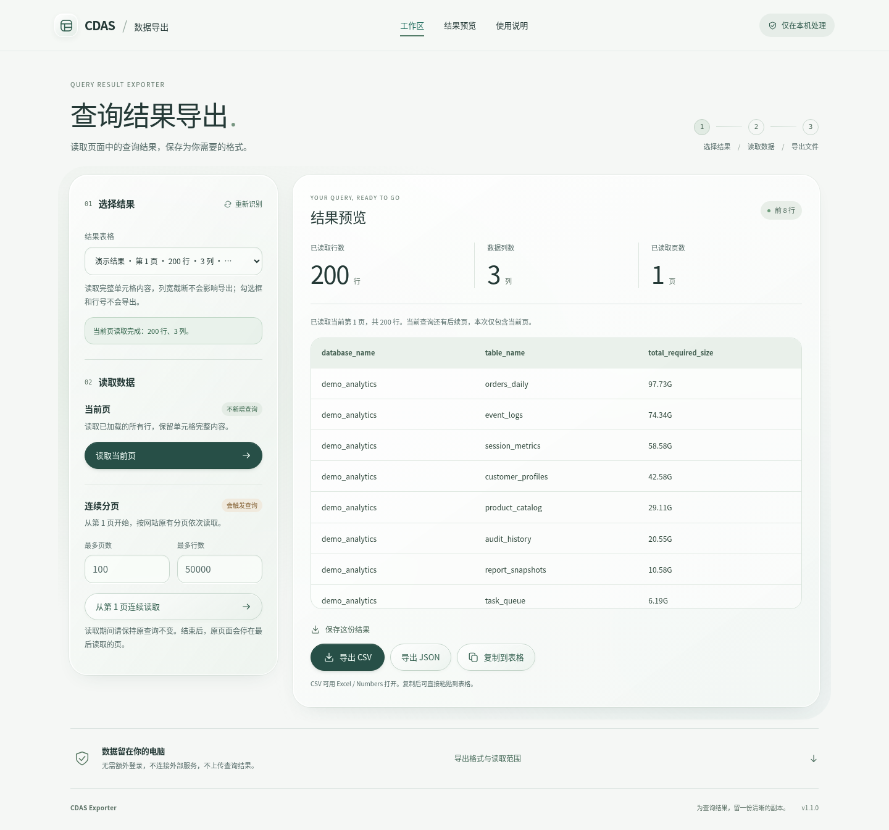

# CDAS Exporter · Lens 界面设计

## 参考与取舍

视觉参考：[Lens · 完整展示](https://ruiqichenbiec.github.io/design-systems/lens/lens-showcase.html)。参考站点在当前云环境中返回 403，设计分析使用其公开仓库中同一路径的页面源码，并在本地 Chromium 中渲染核对。

沿用参考的纸面底色、深绿色文字、圆角玻璃材质、胶囊按钮、轻微的边缘高光和克制留白。没有复制 Lens 的页面或运行时，没有引入 WebGL、声音、拖动透镜和远程字体，避免增加数据导出工具的操作负担。所有图标为本地 SVG 或扩展所需 PNG。

## 布局

- 页头：品牌、工作区/结果预览/使用说明锚点、本机处理说明。
- 标题：明确说明查询结果导出用途，标示选择、读取、导出的操作顺序。
- 桌面工作区：左侧选择结果和控制读取，右侧数据统计、完整值预览和文件导出。
- 小窗口：工作区纵向排列，表格内部横向滚动，不让整页溢出。
- 页脚前：本机处理说明、可用键盘展开的导出格式和分页范围说明。

## 视觉变量

| 用途 | 值 |
| --- | --- |
| 页面纸面底色 | `#f5f7f5` |
| 主文字 | `#243936` |
| 次文字 | `#556b68` |
| 低强调文字 | `#586f62` |
| 主按钮 | `#274f47` |
| 主按钮文字 | `#f4fff9` |
| 分隔线 | `#dbe4e1` |
| 键盘焦点 | `#2576e8`，3px 外轮廓 |
| 面板圆角 | 桌面 30px，小窗口 25px |
| 按钮 | 胶囊形，至少 44px 高 |
| 动态效果 | 180ms；遵循 `prefers-reduced-motion` |
| 字体 | 系统字体，优先 macOS / 中文系统字体 |

主按钮文字对比度约 8.9:1。玻璃面板使用较高不透明度以保证可读性，不支持模糊效果时提供实体背景回退。禁用、正常、成功、警告和错误状态使用文字与样式共同表达。

## 行为边界

保留所有原按钮 ID 和事件绑定。采集器 `collector.js`、格式转换 `formats.mjs`、后台入口 `background.js` 与 v1.0.0 一致；`export.js` 只调整一条面向用户的说明文案。没有额外查询或权限。

「当前页」标示为不新增查询；「连续分页」标示为会触发查询。达到上限、停止或失败时保留「未完成」提示。布局调整不会将未完成结果显示为完整结果。

## 验证与预览

通过 5 项格式单元测试和 17 项真实 Chromium 浏览器检查，覆盖原有功能，以及键盘操作、焦点、减少动态效果和 5 种窗口宽度。受云环境管理策略限制，浏览器检查采用测试专用 Chrome API 桥接，未验证原生扩展安装或真实内网连接。

以下预览全部使用合成演示数据，不包含上传的内网查询记录：

[查看 375px 窄窗口界面](ui-mobile.png)
